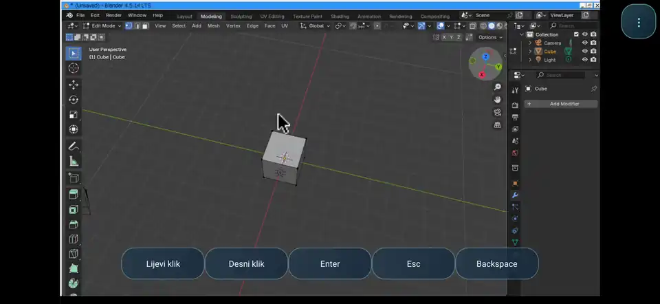
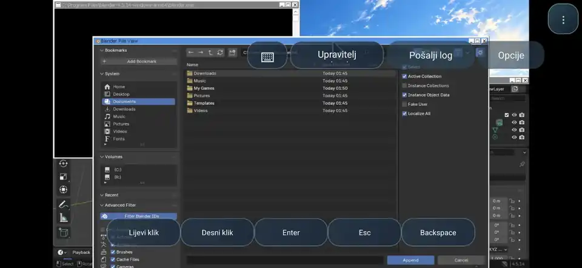

# DRNAS EMU — Android Windows Applications and Games

> **PRE-ALPHA · ACTIVE DEVELOPMENT · WINDOWS APPLICATIONS AND GAMES ON ANDROID**
>
> DRNAS EMU (*EmuExperimental*) is an independent Android project working toward a versatile Windows compatibility environment on ARM-based mobile hardware. **Our primary focus is demanding Windows desktop applications** for professional design, engineering, creative work and music production — with Windows games as an equally important compatibility and performance testing area.
>
> Early builds are experimental and currently shared privately. A public testing release is planned, but there is no fixed release date. **The software names below describe development goals, not confirmed compatibility.**

## What we're targeting

We are particularly interested in pushing Windows software beyond mobile-app limitations:

- **CAD and engineering:** AutoCAD, CATIA, SOLIDWORKS and other demanding desktop design, modeling, simulation and technical tools.
- **Music and creative production:** FL Studio, digital audio workstations, Photoshop, After Effects and other professional creative applications.
- **3D creation:** Blender and similarly demanding modeling, animation and rendering workloads.
- **Windows games:** a major test and use case for our Direct3D, Vulkan, graphics-driver, input and frame-pacing stack.

**Compatibility disclaimer:** AutoCAD, CATIA, SOLIDWORKS, FL Studio, Photoshop and After Effects are **targets for future testing**; we are **not claiming that they currently run** on DRNAS EMU.

## Actual on-device preview — Blender for Windows ARM64

The images below are **real captures from DRNAS EMU on Android**, not stock press artwork. They show Blender 4.5.14 for Windows ARM64 launching through our Wine/X11 environment, including the main 3D interface and the Blender file browser.

<p align="center">
  
</p>
<p align="center"><sub>Blender 4.5.14 Windows ARM64 — live viewport shown on Android in an experimental DRNAS EMU build.</sub></p>

<p align="center">
  
</p>
<p align="center"><sub>Blender File View — a real secondary window; transient window stacking, sizing and focus remain under investigation.</sub></p>

**Current limitations:** secondary Blender windows can be obscured by the main window or extend outside the visible desktop. OpenGL/Vulkan, performance and other application compatibility still require more testing. **Showing a working UI does not establish full CAD, rendering or professional-workflow support.**

## What we're building

DRNAS EMU is designed to combine a native Android interface with a modular Windows execution stack: **native Windows ARM64 through Wine/Proton, x86/x64 support with FEX where needed, DXVK, Vulkan/Turnip, audio and input handling**. Wine and the other components are established upstream projects with their own authors and licenses; our engineering work focuses on Android integration, display, device compatibility, stability and performance.

The project has moved beyond package-import experiments. **Internal tests now show Blender for Windows ARM64 running its GUI on Android through our Wine/X11 environment**, as illustrated above. The app also integrates audio, input, and experimental graphics infrastructure. **Direct3D/DXVK and broader application/game rendering compatibility** remain under active investigation; tests with games such as Crysis are engineering experiments, not general compatibility claims. Rendering correctness, secondary windows, installation and stability still require substantial work.

## Research goal: Qualcomm Hexagon NPU assisting the GPU

An important **future research goal** is to explore using compatible Qualcomm **Hexagon NPU / QNN-HTP** hardware for **asynchronous prediction and decision support** during demanding graphics workloads in applications and games. Possible experiments include learning render-pass patterns or load trends and supplying **non-blocking hints** to the GPU driver's adaptive GMEM/SYSMEM, shader or texture policies.

**The NPU does not render graphics and is not currently implemented as a working GPU acceleration feature in DRNAS EMU.** Access, device compatibility, latency, overhead and measurable benefit must be verified experimentally. The render path must never wait on an NPU result: when a prediction is late, invalid or unhelpful, the GPU must continue using a known-safe native path. The goal is **frametime consistency and stable rendering**, not inflated FPS promises.

## Upcoming pre-alpha

The first external test builds will be labeled **PRE-ALPHA / TESTING ONLY**, with a clear list of known limitations, component credits, reproducible checksums and rollback guidance. We plan to invite feedback on device model, Android version, Windows application or game, execution stack, launch behavior, window handling, visual artifacts, frame pacing and logs. **No public APK is linked here until a release is ready.**

**Author / development:** Frane12 · **Status:** active private development · **README updated:** 18 October 2026

For a shareable announcement, see [Pre-alpha announcement](docs/ANNOUNCEMENT_PRE_ALPHA.md).

---

## Code layout

- `android-app/` — complete Android Gradle application (Java/Android UI; session process manager; local WCP vault; FEXCore TAR/XZ bridge verification).
- `contracts/` — session adapter interface, pointer-ownership router reference.
- `tools/` — Python reference WCP importer for Wine, Proton, FEXCore and DXVK, plus JavaScript syntax check.
- `tests/` — smoke tests and malicious-archive rejection tests for the reference importer.
- `profiles/` — example application/game configuration and JSON profile schema.
- `web-prototype/` — offline console-style UI concept.
- `docs/` — integration architecture, package investigations, Android device tests and constraints.
- `.github/workflows/build-android.yml` — debug APK build.
- `.github/workflows/test-contracts.yml` — Python importer + input/profile contracts + web syntax.
- `.github/workflows/package-source.yml` — ZIP of the source tree.

## Historical V0.3.1 build instructions (legacy)

The following documents an **early V0.3.1 development milestone**, not the latest DRNAS EMU pre-alpha build. For earlier experiments, use **Actions → EmuExperimental - Android APK V0.3.1 Prefix Compatibility** and download the artifact
`Drnas-Console-V0.3.1-Prefix-Link-Fix-debug-apk` from a successful run. The artifact
is a ZIP containing `app-debug.apk`.

To build with Gradle 8.9, Android SDK 35 and Java 17:

```bash
cd android-app
gradle :app:assembleDebug
# android-app/app/build/outputs/apk/debug/app-debug.apk
```

On the phone, **Components → Select local .wcp** to import a local
`FEXCore-2609-GameNative-O3.wcp`, then check whether the app reports
`FEX bridges VERIFIED (not activated)`. The FEX package must not be executed
as a generic Android binary: it includes two Windows PE bridge DLLs. A
matching Proton ARM64EC/Wine loader, compatible Bionic execution layer,
X11/audio/Vulkan integration and ABI checks were **future milestones at the time of this historical build**; newer experiments have since advanced these areas.

## Verified third-party package data

The following real third-party WCP formats were previously inspected in an
isolated CI runner; **no third-party binary packages are tracked in this repo**:

- Proton 10 ARM64EC controller fix: TAR/ZSTD, manifest `type: Proton`.
- DXVK 1.10.3: TAR/XZ, manifest with `system32`/`syswow64` DLL mappings.
- FEXCore 2609 GameNative O3: TAR/XZ, exact `libarm64ecfex.dll` and `libwow64fex.dll` mappings.

More details: `docs/REAL_WCP_SAMPLES.md`, `docs/FEXCORE_2609_GAMENATIVE.md`
and `docs/ANDROID_FEX_BRIDGE_V0_2.md`.

## Ground rules

- Each component version is immutable and independently replaceable.
- No automatic root requirement or system driver replacement.
- No unsafe execution of downloaded archives; untrusted WCP content must be validated.
- Per-game sessions and input pointer ownership are isolated.
- Claims of emulator compatibility require real on-device execution and test logs.
- Keep DXVK/Turnip/FEXCore/Proton third-party source and binary licensing clear.

### Provenance

The V0.2 source code was migrated from private experimental branch
`Frane12/Turnip-Neuro-Private:experiment/drnas-console-v0-concept` into
this standalone `Frane12/EmuExperimental` repository on 2026-10-14.
The Turnip repository was left unchanged.

Project by Frane12 · exploratory hobby and research.
